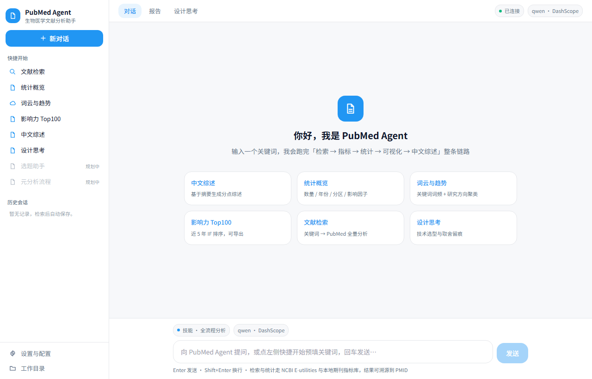
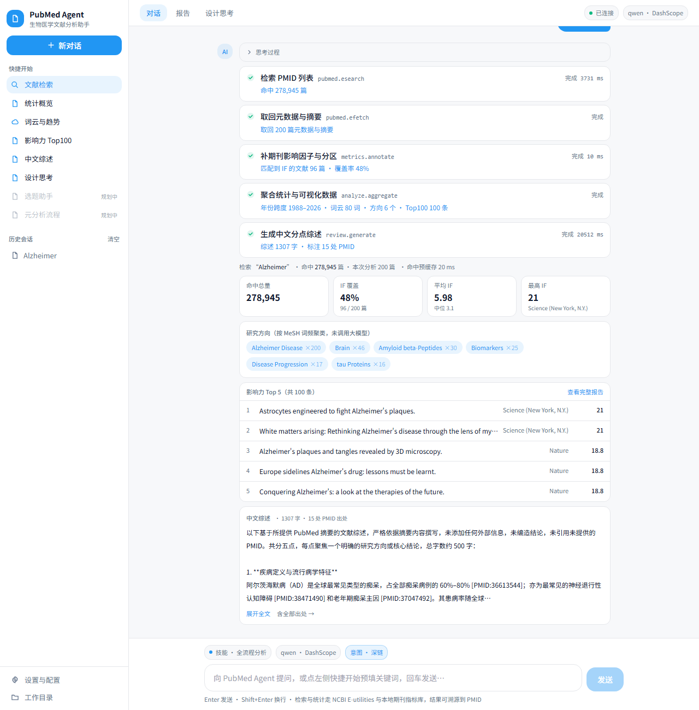
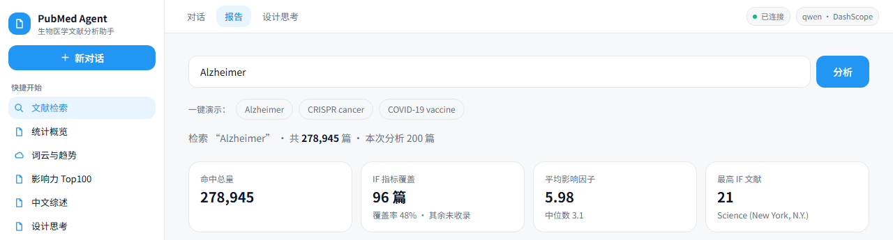
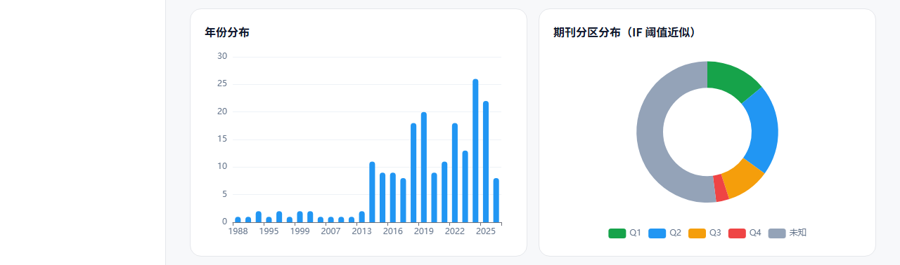
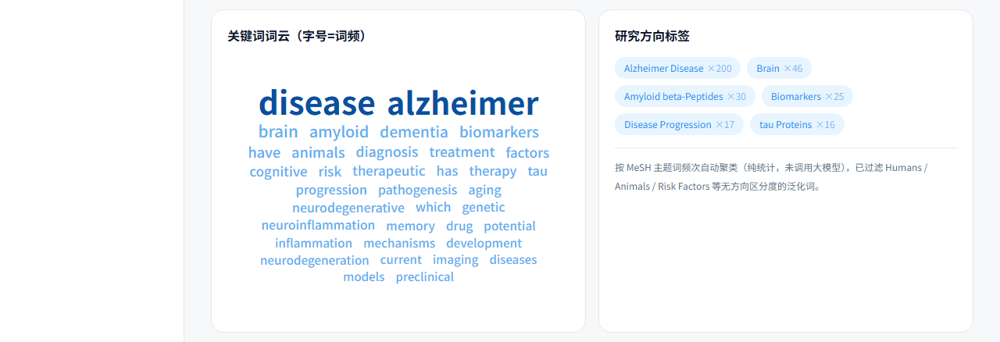
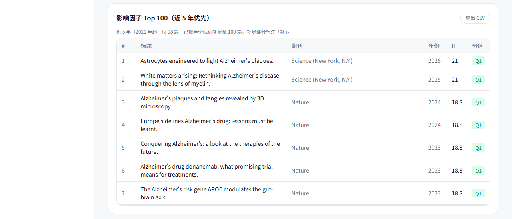

# PubMed Agent · 文献分析 Demo（全栈笔试）

> 沿长科技（成都）全栈开发工程师笔试 —— 关键词 → NCBI 检索 → 统计 + 词云 + 影响力排序 + 中文综述 一站式 web。
> 当前状态：**F1–F4 + 对话式外壳 + 设计思考页 全部完成**并端到端跑通；架构为**单 LLM**（非 RAG、非多智能体）；期刊指标落 **SQLite 单文件**（SCImago + OpenAlex 双源），文献与分析落 **literature.db**（运行时积累）；**支持中文检索**（本地术语映射 + LLM 改写，渐冻症 → ALS 实测全链路打通）。
> 外层是对话式 Agent 外壳（左导航 + 对话流 + 工具调用可见），内核仍是那条已端到端验证过的固定流水线——**升级只加了一层壳，报告链路一行未改**。

## 界面预览

对话式外壳（左侧导航 + 中间对话流 + 工具调用可见）：

| 欢迎页（快捷开始 + 能力卡） | 对话流（工具卡片 + 结果内联） |
|---|---|
|  |  |

「报告」视图（原 F1–F4 完整报告，逻辑未改，只是搬进了独立视图）：

| 概览（检索 + 统计卡 + 中文综述） | 年份分布 / 分区分布 |
|---|---|
|  |  |

| 词云 + 研究方向标签 | 影响力 Top 100 |
|---|---|
|  |  |

## 功能范围（已完成）
- ✅ **对话式外壳**：三栏布局（左导航 / 顶部视图切换 / 主区）、快捷开始、历史会话（localStorage）、输入区技能与模型 chips、后端连接状态实时检测
- ✅ **工具调用可见**：每步渲染为一张工具卡片（名称与入参对齐后端真实函数，结果值取自真实响应），思考过程可折叠，结果内联渲染并可跳转完整报告
- ✅ 关键词 → NCBI E-utilities 真实检索（ESearch + EFetch/XML 并发解析）
- ✅ **F1 统计**：命中总量、年份分布（Alzheimer 场景覆盖 1988→2026）、期刊分区分布（Q1–Q4 + 未知）、影响因子统计（均值/中位/极值）、IF 指标覆盖率
- ✅ **F2 可视化**：关键词词云（纯 DOM 渲染，字号∝词频、色阶分档）+ 研究方向标签（MeSH 聚类，纯统计不用 LLM）
- ✅ **F3 排序**：影响因子 Top 100 表格（近 5 年优先，样本不足时按年份就近补足并标注）+ 一键 CSV 导出
- ✅ **F4 综述**：取 Top 摘要 → 中文分点综述（约 500 字），每条论断可溯源 `[PMID: xxxxx]`
- ✅ 设计思考页（含界面升级与工具卡片边界的说明，命中"体现对该工具的思考"加分项）
- ✅ 前端现代 SaaS 风格（浅色卡片化），三栏外壳与原报告视图共用同一套设计 token

## 技术栈
- 后端：Python + FastAPI + httpx（异步并发）+ python-dotenv
- 数据源：NCBI E-utilities（免费，可挂 `NCBI_API_KEY` 提限流）
- 期刊指标：SQLite 单文件 `data/journal_metrics.db`——**SCImago 2025 全量 32,193 条（含源方已发布分区）+ OpenAlex 2,709 条**双源落库，ISSN 索引 58,789 行；构建期抓取、运行时零联网，缺失降级"未知"（详见「数据来源」）
- 综述 LLM：DashScope qwen（OpenAI 兼容接口），无 key 时按真实统计生成示例综述
- 前端：Vite + React + TypeScript + Tailwind CSS + ECharts（**按需注册**：bar/pie/grid/tooltip/legend）+ 自研 DOM 词云
- 存储：双 SQLite——`journal_metrics.db`（指标，只读随包）+ `literature.db`（文献/命中集/分析快照/术语映射，运行时积累）；另含进程内存缓存 + 文件预缓存 + localStorage（历史会话）

## 目录结构
```
pubmed-analytics/
├── backend/
│   ├── app/
│   │   ├── config.py      # 环境变量与配置
│   │   ├── pubmed.py      # NCBI 检索（esearch + efetch 批量 XML 解析）
│   │   ├── journaldb.py   # 期刊指标 SQLite 层（建表/写入/ISSN 索引/溯源 meta）
│   │   ├── literaturedb.py# 文献库 SQLite（检索词/文献/命中集/分析快照/术语映射）
│   │   ├── query_translate.py # 中文查询改写（L0 映射表 → L1 LLM → 试搜护栏）
│   │   ├── metrics.py     # 指标加载与刊名/ISSN 归一化匹配（DB 优先，JSON 回落，缺失降级）
│   │   ├── cache.py       # 缓存键（query × max_results × include_review）
│   │   ├── analyze.py     # 聚合：年份/分区/IF/词频/主题/Top100
│   │   ├── review.py      # 中文综述（qwen / 按真实统计生成的示例综述）
│   │   ├── pipeline.py    # 检索→聚合→综述 统一响应体（main 与 precache 共用）
│   │   └── main.py        # FastAPI 入口 + /api/analyze + CORS + 缓存
│   ├── data/journal_metrics.db    # 期刊指标 SQLite（SCImago + OpenAlex 双源，见「数据来源」）
│   ├── data/journal_metrics.json  # OpenAlex 快照（build_metrics_db.py openalex 的导入源）
│   ├── scripts/build_metrics_db.py        # 双源落库 CLI：scimago / openalex / all / stats / verify
│   ├── scripts/build_metrics_openalex.py  # OpenAlex 抓取（两阶段：分页抓取 + 关键词回填）产出 JSON 快照
│   ├── scripts/precache.py                # 演示预缓存生成（PRESETS 跑真实管线写 cache/）
│   ├── scripts/seed_term_mapping.py       # 中文术语映射表预置（81 条，交付期审核固化）
│   ├── scripts/migrate_cache_to_db.py     # 旧缓存迁移进 literature.db
│   ├── cache/                             # 演示预缓存（启动自动载入内存）
│   ├── .env.example       # 配置模板
│   ├── requirements.txt
│   └── .venv/             # 已建虚拟环境（阿里云 PyPI 镜像）
├── frontend/
│   ├── src/App.tsx        # 入口：仅挂载外壳
│   ├── src/ReportView.tsx # 「报告」视图 = 原 F1–F4 报告逻辑整体迁移（未改逻辑）
│   ├── src/Thinking.tsx   # 设计思考页
│   ├── src/api.ts         # 调 /api/analyze（类型定义）
│   ├── src/EChart.tsx     # ECharts 封装（按需注册 + ResizeObserver 自适应）
│   ├── src/WordCloud.tsx  # 自研纯 DOM 词云（无 canvas 插件依赖）
│   ├── src/agent/         # 对话式外壳（本次新增，自包含，不侵入既有模块）
│   │   ├── AgentShell.tsx # 三栏骨架 + 视图切换 + 会话状态 + 连接检测
│   │   ├── Sidebar.tsx    # 左导航：品牌 / 新对话 / 快捷开始 / 历史 / 配置 / 工作目录
│   │   ├── ChatPanel.tsx  # 对话流 + 输入区 + 工具卡片推进编排
│   │   ├── ToolCard.tsx   # 工具调用卡片（入参可展开）
│   │   └── model.ts       # 数据模型 + 快捷开始定义 + 工具模板 + 会话持久化
│   └── dist/              # 已 build（591 模块 / gzip 228 KB）
├── docs/                  # 界面截图（README 引用）+ 交付文档 docx ×5
└── .gitignore             # 排除 node_modules / .venv / dist / .env / cache
```

## 交付文档

除代码外，五份说明文档随仓库一并提供，位于 `docs/`（与界面截图同目录）：

| 文档 | 说明 |
|---|---|
| `docs/需求评审报告.docx` | 逐字引用笔试要求，识别 3 处硬卡点（IF/分区数据源、LLM 综述、PubMed 限流）与 8 个待拍板问题 |
| `docs/竞品调查报告.docx` | 5 款代表性竞品对比（Elicit / Connected Papers / 文献计量类等），提炼差异化切入 |
| `docs/开发实施文档.docx` | 架构、模块、接口、实现细节与「规划 vs 实装」差异对照（16 节） |
| `docs/数据库设计文档.docx` | 数据分层、指标数据集结构、缓存与对话外壳本地状态（12 节） |
| `docs/演示讲解稿.docx` | 现场演示的逐步讲解脚本 |

## 快速启动

### 1. 后端
```bash
cd backend
cp .env.example .env        # 可选：填 DASHSCOPE_API_KEY 用真实 qwen；留空则按真实统计生成示例综述
.venv/Scripts/pip.exe install -r requirements.txt   # 已装好

# 不配任何 key 也能完整演示（现场推荐）：
MOCK_LLM=1 .venv/Scripts/uvicorn.exe app.main:app --host 127.0.0.1 --port 8000
# 真实 LLM 模式（在 .env 填好 DASHSCOPE_API_KEY）：
.venv/Scripts/uvicorn.exe app.main:app --host 127.0.0.1 --port 8000

# 离线预生成演示缓存（一键演示不翻车；建议演示前在能联网的环境跑一次，约 15 秒）：
MOCK_LLM=1 .venv/Scripts/python.exe scripts/precache.py
# 启动后后端自动从 cache/*.json 载入内存；前端「一键演示」按钮直接命中，断网也能秒回

# 重建期刊指标库（交付包内 .db 已就位，通常无需执行；重建需联网）：
.venv/Scripts/python.exe scripts/build_metrics_db.py all      # SCImago 下载落库 + OpenAlex 快照导入
.venv/Scripts/python.exe scripts/build_metrics_db.py stats    # 查看两源规模、分区分布与溯源 meta
.venv/Scripts/python.exe scripts/build_metrics_db.py verify   # 抽样核对（CA / BMJ / Nature / Science ...）

# 验证：
curl http://127.0.0.1:8000/api/health
curl -X POST http://127.0.0.1:8000/api/analyze -H "Content-Type: application/json" \
  -d "{\"query\":\"Alzheimer\",\"max_results\":200,\"include_review\":true}"
```

### 2. 前端
```bash
cd frontend
npm install            # 已装好（react / echarts 已含）
npm run dev            # 开发服务器 http://127.0.0.1:5173
# 或生产预览：
npm run build && npm run preview
```
> 前端 `api.ts` 直连 `http://localhost:8000`（演示时改 hosts/端口一致即可）。
> **深链**（现场演示可直接进任意视图）：
> - `/?q=Alzheimer` → 报告视图并自动分析（升级前的既有行为，已保留）
> - `/?chat=Alzheimer` → 对话视图并自动跑一次完整链路
> - `/?tab=design` → 直接进设计思考页

## 配置项（.env）
| 变量 | 说明 | 默认 |
|---|---|---|
| `DASHSCOPE_API_KEY` | 阿里云百炼 qwen key（真实综述） | 空=按统计生成示例 |
| `DASHSCOPE_BASE_URL` | DashScope OpenAI 兼容地址 | https://dashscope.aliyuncs.com/compatible-mode/v1 |
| `LLM_MODEL` | 模型名 | qwen-plus |
| `NCBI_API_KEY` | NCBI E-utilities key（提限流） | 空 |
| `NCBI_TOOL` / `NCBI_EMAIL` | 礼貌参数 | pubmed-analytics |
| `MAX_RESULTS` | 检索上限 | 1000 |
| `REVIEW_TOP_N` | 综述取摘要篇数 | 30 |
| `MOCK_LLM` | 强制走示例综述 | 无 key 自动 true |
| `CACHE_DIR` | 文件预缓存目录 | `backend/cache` |

## 数据来源（期刊 IF / 分区）

PubMed 官方不返回影响因子与分区，因此指标数据集在**构建期**从公开来源抓取、落 SQLite 单文件随包发布，运行时零联网依赖。库文件 `backend/data/journal_metrics.db`（约 18 MB），由 `app/journaldb.py` 提供建表/写入/查询：

| 来源 | 规模 | 说明 |
|---|---|---|
| `scimago`（优先） | 32,193 条（期刊 30,412） | SCImago Journal Rank 2025 全量导出（11.25 MB CSV）。带**源方已发布分区**（SJR Best Quartile：Q1 9,470 / Q2 7,916 / Q3 7,116 / Q4 6,585）、SJR、近 2 年篇均被引，以及期刊类型（剔除非期刊条目）与 Coverage 活跃区间（识别停刊） |
| `openalex`（兜底） | 2,709 条 | OpenAlex sources API 的 `2yr_mean_citedness`，分区为按被引阈值推算；仅当某 ISSN 未被 SCImago 覆盖时才生效 |

关键设计：

- **口径分列、不合并**：两源指标口径不同，分列存放以杜绝"A 源数值配 B 源分区"的静默串味；查询时 SCImago 优先、OpenAlex 只兜底。
- **ISSN 独立索引表**：印刷号 + 电子号拆到 `journal_issn`（两源共 58,789 行），ISSN → 期刊是一次索引命中。
- **刊名归一化匹配**：抹平 PubMed 的 5 种常见写法差异——`括号限定词`（Science (New York, N.Y.)）、`句点`（Nature reviews. Cancer）、`主标题 : 缩写`（Journal of Alzheimer's disease : JAD）、`标题 = 平行标题`、`开头缩写前缀`（JPMA. ...）。
- **同名刊用 `(source, source_id)` 唯一**：SCImago 存在同名不同 Sourceid 的条目（不同学科分类独立计），不能拿刊名当唯一键。
- **溯源可回查**：每个来源的抓取 URL、时间、原始文件 SHA-256、口径说明、许可注记全部落在 `dataset_meta` 表；`scripts/build_metrics_db.py stats` / `verify` 可随时核对。
- **历史脏值已消除**：旧 OpenAlex-only 数据集存在停刊刊 367.0 霸榜、BMJ=0.0 等脏值；SCImago 覆盖后 BMJ=2.95、Nature=18.62、CA=285.55（`verify` 子命令可复现）。残余风险：个别只被 OpenAlex 收录的长尾条目仍可能带出离群值（如 Chem Comm 旧刊号 367.0），三个预设实测 Top100 未受影响。
- **口径注记**：两源的指标本质都是「近 2 年篇均被引」，系统性低于 JCR 影响因子（SCImago 分母含社论/letters 等非可引用项）；UI 沿用「影响因子(IF)」称谓，精确口径以本节与库内 `dataset_meta` 为准。
- 未收录期刊如实降级「未知」，不编造数值；前端概览卡展示 IF 指标覆盖率。
- 重建：`python scripts/build_metrics_db.py all`（SCImago 需联网且需完整浏览器头，OpenAlex 限流期间直接导入磁盘快照即可，免联网）。

## 技术取舍（为什么这么做）
| 决策点 | 选择 | 理由 |
|---|---|---|
| 界面形态 | **网页内做对话式外壳**，不做桌面应用 | 笔试要求是「独立开发一个网页 demo」；桌面壳（Electron）会偏离要求且演示成本更高。参考了科研 Agent 类产品的交互范式，但只取其"过程可见"的内核，形态仍留在浏览器里。 |
| 升级边界 | **只加外壳，不动报告链路** | 报告链路已端到端验证过，为换皮重写它风险与收益不成比例。做法是把原报告逻辑整体迁到 `ReportView.tsx` 作为独立视图，**逻辑一行未改**，对话只是新的入口层。 |
| 工具卡片 | 卡片**对齐后端真实函数**，结果值取自真实响应 | 卡片名与入参直接用 `pubmed.esearch` / `pubmed.efetch` / `metrics.annotate` / `analyze.aggregate` / `review.generate`，顺序即真实执行顺序；数值全部来自 `/api/analyze` 响应。**需如实说明**：后端目前是一次性返回，故卡片"逐步点亮"是前端按真实阶段做的回放、不是服务端推送；汇总行显示的是**接口真实往返耗时**而非播放时长。下一步改 SSE 增量推送即可去掉回放层。 |
| 快捷开始清单 | 6 项真实能力 + 2 项显式标注「规划中」 | 把没做的东西列成已完成，在演示追问下必然被问穿；不如当路线图如实交底（选题助手 / 元分析流程尚未实现）。 |
| 词云实现 | **自研纯 DOM**（不用 echarts-wordcloud） | canvas 词云依赖容器实测宽高做贪心排版：SPA 首帧尺寸未稳、图表重绘、无头截图等场景下容易整块画不出来，排布结果也不可预期。改为 DOM 文本流后：字号按词频 `sqrt` 压缩（15~41px，长尾词不会被压成噪点）、颜色按频率分 4 档品牌蓝且**与字号严格对应**（避免"字大色浅"的视觉错位），渲染确定、无空白面板风险，文字还可选中/检索/缩放不糊。只取词频前 36 个词——词太多会把容器塞满小字反而看不清层次。 |
| ECharts 引入方式 | **按需注册**（core + bar/pie/grid/tooltip/legend） | 全量 `import "echarts"` 打包 1.19 MB；按需后 **678 KB（gzip 228 KB）**，体积减少 43%。代价是新增图表类型需手动补注册，已在 `EChart.tsx` 注释说明。 |
| 分区标准 | **SCImago 官方发布分区为主**，OpenAlex 阈值推算兜底 | JCR 为 Clarivate 付费授权数据，GitHub 扒表有版权/DMCA 风险，不进交付物；中科院分区 2026-03 起停更。SCImago 免费开放且自带官方分区（早期 403 是缺浏览器头，补齐 UA/Referer 后实测可稳定下载）。两源口径在库内分列、SCImago 优先，UI 不标「JCR」以免误导。 |
| 期刊指标 | 构建期抓取落 SQLite + 运行期零联网 | 演示现场网络不可控；指标构建期落 `journal_metrics.db` 随包发布，运行时只读本地单文件（标准库 sqlite3，零第三方依赖），未收录期刊如实降级"未知"而非编造数值。 |
| 综述生成 | 单次 LLM 调用（非 RAG / 非多智能体） | 输入是已检索到的 Top-N 摘要（自带上下文），无需向量库检索；单次调用延迟低、链路短。多智能体/RAG 的数据量与调试成本对 demo 不成正比。 |
| 无 key 时的综述 | 用**真实统计**拼装分点综述 | 空 key 场景下若返回一段与数据无关的占位话，F4 就没法看。改为把命中量、年份跨度、主题聚类、分区与 IF 分布写成 4~5 点并附真实 PMID 出处（实测 587~641 字），现场不配 key 也能展示 F4 的实际形态；是否调用大模型由响应体 `mock` 字段标记、前端据此提示。 |
| 检索排序 | `sort=relevance`（非 `pub_date`） | 按时间倒序会让样本全部挤在最近年份，年份分布退化成"1–2 根柱子"；改相关性排序后年份跨度达 1988→2026，分布图才有分析价值。 |
| 会话持久化 | 浏览器 localStorage（未落库） | 本次只在壳层，历史会话属于 UI 态；为它引入后端存储会扩大改动面。后续落库支持跨设备（见设计思考页路线图）。 |

## 验证结果（2026-09-18 晚，v2——指标库 SQLite + 文献落库 + 中文检索 全链路复测）

以下数字全部来自**真实链路实测**——真实 NCBI 检索 + 只读本地指标库，可用 `python scripts/precache.py` 逐条复现：

- **检索**：真实调 NCBI E-utilities，各取前 200 篇分析——Alzheimer 命中 **278,960** 篇 / CRISPR cancer **18,121** / COVID-19 vaccine **61,233** / 渐冻症（中文改写后）**41,712**。
- **F1 统计**：年份分布 Alzheimer 1988→2026（26 个年份）、CRISPR cancer 2014→2027（14 个）、COVID-19 vaccine 2020→2025（6 个）；分区分布为 **SCImago 官方分区**（Alzheimer：Q1 112 / Q2 39 / Q3 26 / Q4 14 / 未知 9）；篇均被引统计齐备（Alzheimer 均值 4.80、中位 3.22、最高 18.62；CRISPR cancer 均值 9.55、最高 40.4）。
- **F2 可视化**：词云 80 词 + MeSH 研究方向 6 个（三预设一致，已过滤 Humans/Animals 等泛词）。
- **F3 Top100**：各预设均返回 100 条并支持 CSV 导出。Alzheimer 近 5 年样本 95 篇、按年份就近补足 5 条（界面与导出标注「补」）；CRISPR cancer（129 篇）/ COVID-19 vaccine（189 篇）无需补足。
- **F4 综述**：真实大模型（qwen-plus）基于摘要原文生成 1200+ 字中文分点综述，关键论断带 `[PMID: xxxxx]` 标注且无越界 PMID（指标库切换前实测；综述只依赖 Top-N 摘要、不读指标库，切换不受影响）。不配 key 时改为基于本次真实统计拼装的分点综述（响应体 `mock: true`，前端如实提示）。
- **指标覆盖**：Alzheimer **95.5%**（191/200）/ CRISPR cancer **99.0%** / COVID-19 vaccine **99.0%**——SCImago 全量入库后长尾刊基本全覆盖；离群条目（375 条）已在匹配层过滤。
- **对话外壳**：工具卡片结果值与后端实测逐项一致（Alzheimer：命中 278,960 / 匹配指标 191 篇即 95.5% / 词云 80 词 · 方向 6 个 · Top100 100 条），无编造数值。
- **中文检索（v2 新增）**：「渐冻症」经本地术语映射改写为 amyotrophic lateral sclerosis（105ms），命中 41,712 篇；长尾词「肠漏综合征」LLM 改写为 Intestinal Permeability（含检索验证护栏 4.6s），命中 34,316 篇、指标覆盖 100%。文献与分析已落 `literature.db`，ISO 缩写别名自学习 184 个。
- **性能**：三预设命中预缓存秒回（断网可演示）；真实首跑 200 篇总耗时约 21s，其中 NCBI 网络 19%、本地计算 <1%、大模型 81%——提速应换更快模型而非调小 `REVIEW_TOP_N`（30 篇 20.5s vs 10 篇 19.8s）。
- **渲染**：已用真实浏览器（headless Chrome）逐屏截图核验外壳欢迎页、对话流工具卡片、报告总览/图表/词云/Top100，无空白面板（截图见 `docs/`）。

## 开发流程约定

仓库：`git@github.com:Zlm-hub/PubMed-Agent.git`（走 SSH；本机 HTTPS 直连 GitHub 会被 reset）。

- 主干为 `main`，所有改动经分支合入，不直接在 `main` 上改。
- 分支命名：`feat/<scope>`、`fix/<scope>`、`refactor/<scope>`、`docs/<scope>`、`chore/<scope>`。
- 提交信息用 Conventional Commits，标题一行说清「做了什么」，正文写「为什么这么做」与影响面。
- 提交前跑通：前端 `npm run build`（含 `tsc -b` 类型检查）、后端 `curl /api/health` 与一次 `/api/analyze` 真实请求。
- 密钥与运行时不入库：`backend/.env`、`backend/cache/`、`frontend/dist/`、`node_modules/` 见 `.gitignore`；`journal_metrics.db`（指标，可重生）默认排除、随包发布需 `git add -f`；`literature.db`（用户积累数据）建议随包备份。

## 已知优化点（非阻塞）
- **工具卡片是前端回放而非服务端流式**（后端 `/api/analyze` 为一次性返回）。要变成真流式需改 SSE 增量推送；这是实现细节，不影响功能完整度，但演示时若被问需如实说明。
- **离群值护栏已上线**：OpenAlex 兜底条目入库即打 `flagged` 标记（篇均被引为 0 或 >100，已标记 375 条），指标匹配在 SQL 层过滤——停刊旧刊号 367.0 这类极端值不再可能透出。残余风险仅为 SCImago 覆盖范围内的极端但真实值。
- 分区是 **SCImago 官方分区（SJR Best Quartile）**而非 JCR 分区；OpenAlex 兜底条目的分区为阈值推算。两者口径已在库内分列，UI 不标「JCR」。
- OpenAlex 对单 IP 限流严（实测 Retry-After 可达 16 小时）；`build_metrics_db.py openalex --live` 在限流期间会失败，直接导入磁盘快照即可。
- 指标库为 18 MB SQLite 单文件，`.gitignore` 默认排除（可由脚本重生）；若演示要求零联网零构建，`git add -f backend/data/journal_metrics.db` 显式纳入即可。
- 打包后仍有 675 KB（echarts 运行时本体），如需进一步压缩可做 `manualChunks` 拆包 + 路由级懒加载；当前单页应用收益有限，未做。
- 真实 LLM 综述需填 `DASHSCOPE_API_KEY`（笔试可报销额度内）。
- `config.CACHE_TTL` 已定义但当前代码未引用，缓存实际不过期——演示场景下是有意为之（预缓存不失效），如需生产化需接入过期判定。

## 演示建议
1. 演示前在能联网环境跑一次 `scripts/precache.py` 生成缓存（现场断网也能秒出）。
2. 启动后端（`MOCK_LLM=1` 即可）+ 前端 `npm run dev`。
3. **动线**：① 对话视图欢迎页讲外壳与快捷开始 → ② 点「文献检索」预填关键词并发送，看 5 张工具卡片推进与结果内联 → ③ 点「查看完整报告」切到报告视图，展开图表 / 词云 / Top100 → ④ 导出 CSV → ⑤ 切设计思考页讲取舍。
4. 讲解主线：过程可见 + 一站式 + 中文优先 + 数据可溯源（每段综述跳 PMID）+ 工程取舍（见「技术取舍」）。
5. 若被问到工具卡片的真实性，直接指 `frontend/src/agent/model.ts` 顶部的注释与 `ToolCard` 的数据来源，如实说明回放与流式的差别。
